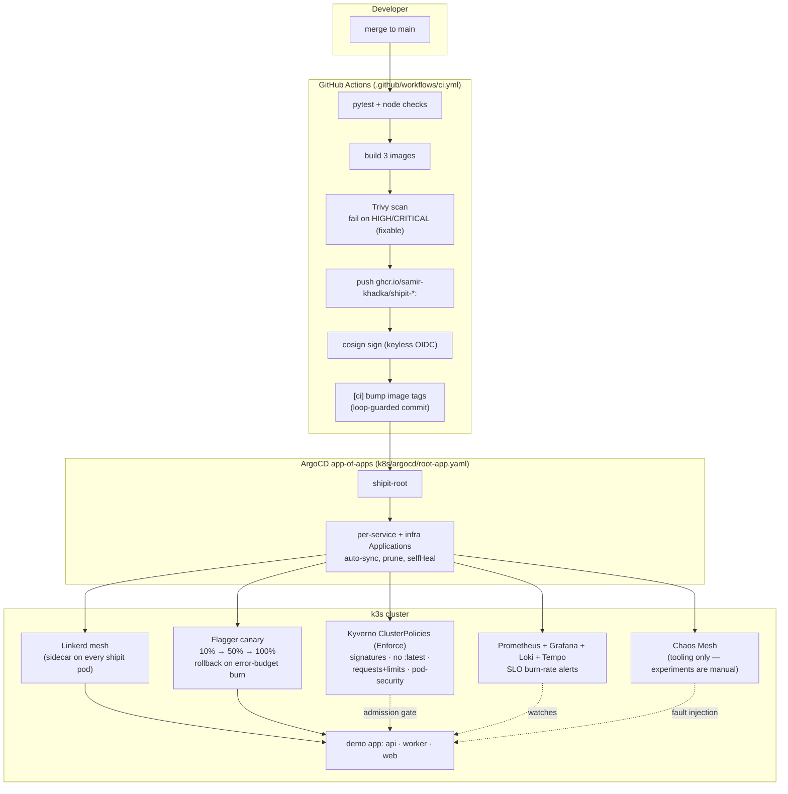

# ShipIt architecture

The whole platform in one picture: you merge code, the platform does
everything else — build, scan, sign, deploy, canary, observe, heal.
Nobody touches the cluster by hand.

## The loop, step by step

1. **Merge.** A PR merges to `main`.
2. **CI** (`.github/workflows/ci.yml`): tests run → 3 images build →
   **Trivy** scans each image and fails the build on HIGH/CRITICAL
   vulnerabilities with a fix available → images push to GHCR with immutable
   `:<sha>` tags → **cosign** signs each digest with a keyless Sigstore
   signature minted from the workflow's OIDC identity → CI commits
   `"[ci] bump image tags to <sha>"`, rewriting only `k8s/base/*.yaml`. The
   `[ci]` marker skips the rebuild (loop guard) — the loop terminates.
3. **ArgoCD** (app-of-apps: `k8s/argocd/root-app.yaml` → `k8s/apps/*.yaml`)
   sees the tag-bump commit and syncs automatically (prune + selfHeal).
   Nobody runs `kubectl apply` after bootstrap.
4. **Kyverno** admission policies (Enforce) vet every pod: the image must
   carry a valid keyless signature from main-branch CI
   (`require-image-signatures`), no `:latest` tags, every container sets
   CPU/memory requests+limits, no privileged containers, runAsNonRoot.
   Upstream infrastructure namespaces (linkerd, linkerd-viz, flagger,
   monitoring, chaos-mesh) are explicitly carved out — documented in the
   policies, proven by CLI tests in `k8s/security/tests/`.
5. **Flagger + Linkerd** (Phase 3): the new api pods become a canary.
   Traffic shifts 10% → 50% → 100% via a Gateway API HTTPRoute that
   Flagger manages and Linkerd's data plane enforces. Every 30s Flagger
   checks the canary's success rate (≥99%) and p99 (≤500ms) against
   canary-scoped MetricTemplates. Burn the budget → the canary halts and
   traffic returns to the primary. Green → the canary is promoted.
6. **Observability** (Phase 4): the api exposes `/metrics` (Prometheus),
   ships OTel spans to Tempo, promtail tails pod logs into Loki. Grafana
   dashboards (`k8s/observability/dashboards/`) show golden signals and SLO
   burn rates; Alertmanager routes the burn-rate alerts (placeholder
   receiver — wire your own).
7. **Chaos** (Phase 5): Chaos Mesh is installed as GitOps-managed tooling,
   but experiments are applied **by hand** during a demo (`k8s/chaos/`).
   Pod-kill proves self-healing (the Deployment recreates the pod);
   network-delay proves the observability stack reacts (p99 climbs, traces
   show it). Every experiment is self-terminating (`duration`) and scoped
   to the `shipit` namespace.

## Design decisions worth knowing

- **Two Prometheuses, on purpose.** Flagger's `metricsServer` points at
  linkerd-viz's bundled Prometheus (`http://prometheus.linkerd-viz:9090`).
  kube-prometheus-stack is additive; removing linkerd-viz would break canary
  analysis.
- **Gateway API provider for Flagger, not the `linkerd` provider.**
  Flagger 1.45.0's `linkerd` provider drives SMI TrafficSplits, which
  Linkerd 2.14 no longer implements (verified in the Flagger source). The
  supported path is `meshProvider: gatewayapi:v1` — Flagger manages an
  HTTPRoute, Linkerd enforces the split.
- **Canary-scoped metrics.** Flagger's built-in Linkerd queries use a
  `deployment=~` regex that also matches the `-primary` deployment; the
  custom MetricTemplates in `k8s/canary/metrics.yaml` use an exact match so
  the analysis judges the canary alone.
- **ArgoCD ↔ Flagger truce.** Flagger mutates the Deployment's replicas and
  the apex Service's selector at runtime; `ignoreDifferences` +
  `RespectIgnoreDifferences=true` stop selfHeal from reverting them.
- **cosign v2, not v3.** cosign v3 stores signatures via the OCI 1.1
  referrers API; Kyverno v1.19.2 only reads the legacy `.sig` tag scheme.
  CI pins cosign v2.4.3 so signer and verifier agree.
- **Chaos experiments are manual.** A GitOps-synced pod-kill would fire
  during recordings and everyday use. The tool is GitOps-managed; the
  experiments are deliberate actions with durations and a `shipit.io/demo-only`
  label.
- **loki-stack is deprecated upstream** (noted in its values file with the
  migration path); it stays because it's the lightest single-chart
  Loki+promtail path for a free-tier node.

## Honest constraints

- **Free tier, everywhere.** k3d on a laptop today, Oracle Ampere later —
  same manifests. GHCR hosts images, all tooling is open source.
- **24h retention** on Prometheus/Loki/Tempo (free-tier disk). SLI windows
  are 24h, not 30d; the burn-rate alert math is window-agnostic and stays
  correct.
- **The live cluster runs on your machine.** This repo's sandbox can't run
  k3s (no cpu cgroup v2), so everything is statically validated
  (kubeconform, promtool, Kyverno CLI, rendered-chart checks) and the
  cluster half runs via `scripts/bootstrap.sh` / `bootstrap.ps1`.
- **Alertmanager's receiver is a placeholder.** No fake Slack/PagerDuty —
  wire a real one in `k8s/observability/kube-prometheus-values.yaml`.
- **No live canary/chaos run is claimed.** The demo scripts describe exactly
  what to run; the first live run happens on a real host.
